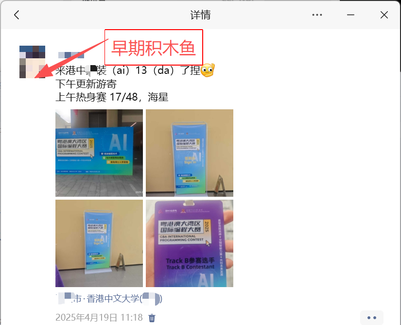
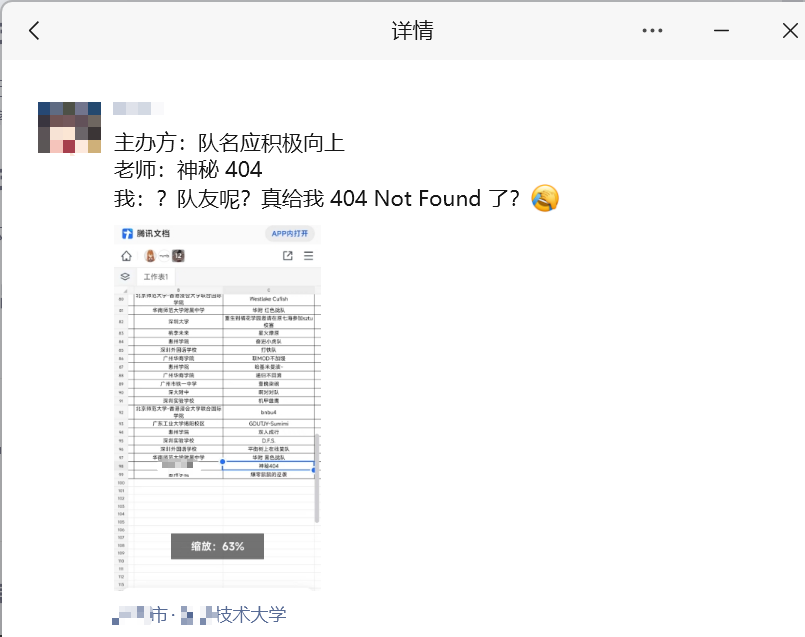
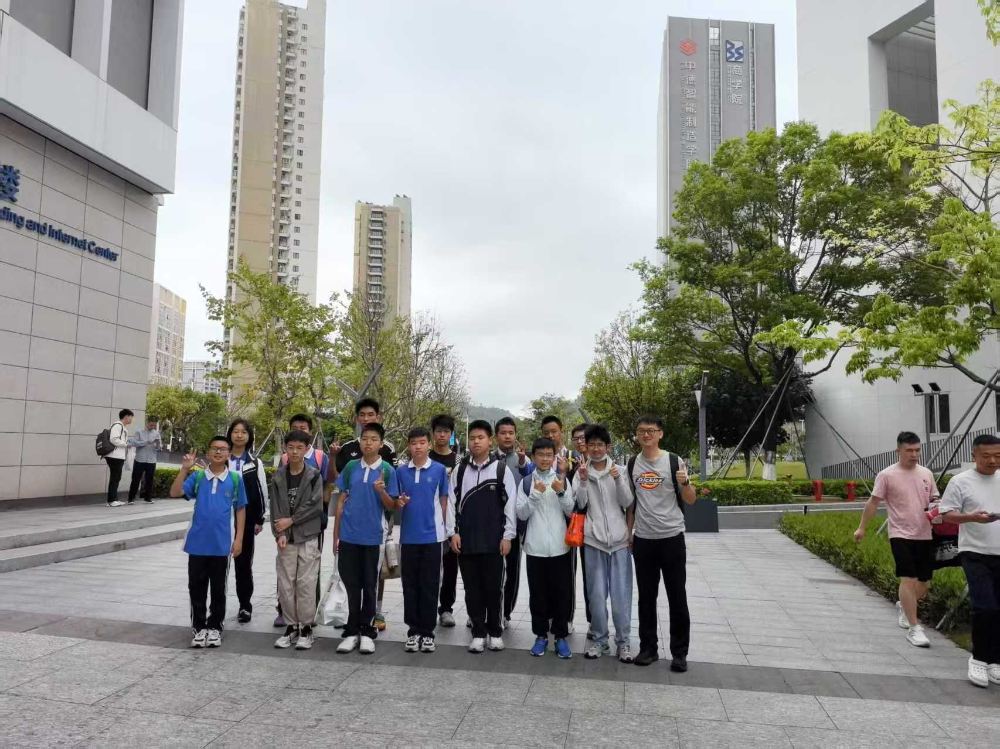

~~小 L~~积木鱼~~残血~~复活啦！最近在研究 whk，OI 也比较废，姑且就写写游记水一水吧。

由于电脑比较烂删了很多必要的组件，加上之前一段时间写的都是长文（当然，都没写完），因此拖更了很长时间，不好意思哈！

本次依然按照时间顺序~

~~无~~趣味提问：不用快捷键，快来快来数一数，本文中有几个“莫名其妙”（包含这一个）？~~24678。~~

# Day $-\infty$

~~N 多 years ago~~，老师莫名其妙的找了个 CUHK(【某经济特区】) 的比赛名额，~~小 L~~积木鱼 作为这一届~~前~~最强的选手自然也要来参加！

然鹅，期中考逝就要到了，~~小 L~~积木鱼 只好把 whk 时间提高到了 $900\%$（别问我为啥这么莫名其妙）

后面又多了个去 SZTU 的比赛。

笑点解析：~~小 L~~积木鱼 从 PS 干到 GM （~~小 L~~积木鱼 所在的【某经济特区】的两个区）才上的 5231（指现在这个学校，~~这是~~小 L~~积木鱼 字丑闹出来的笑话~~ awa），本想着到其他地方上课、比赛啥的可以近一点，结果比赛的时候又给我干回 PS 去了……

# Day 1

本次比赛官方名称叫什么“国际编程大赛”。学校在离 PS 很近的 LG（不是你谷啦）区。让我比较惊喜的是可以带纸质资料哎！~~虽然实践表明没啥大用~~

## 上午热身赛

本来到的比较早的了（总部那些人上午的热身赛干脆不打了），但是到了地方还是人巨多。而且我竟然不知道自己是哪个赛道的（有 A、B、C 三个，后续得知 A 是内部的，B 是~~小 L~~积木鱼 这种~~xxs~~中小学生的，C 打得好可以保博）

经过不懈的——排队，拿到了参赛证，进入机房，结果机子死活登不上去。后面改了三五回密码，终于进去了（密码的！）

这里莫名其妙的只能用 Dev-C++ ~~这种老古董~~，VSCode 没配置（考场机器老毛病了），鉴于是 ACM 赛制要卡时间就不用了。

上午 Track B 参赛 48 人，~~小 L~~积木鱼 以做出 $1$ 题的成绩位列第 17 名（一共 $4$ 道题）。

笑点解析：比赛提供中英双语题面，中文在 B 题的链接里，点了 A 题链接看到题目就开始做的~~小 L~~积木鱼 愣是仗着自己英语好看了半天的英文题面。

## 中午

先是打了 GD 省 CIE 的一场弱智比赛。从上周莫名其妙的延期到这天的，理由竟是服务器炸了？还 TM 只有选判，若只啊……这还是那个敢对战 CCF 的 CIE 吗？校内信号还贼差（只允许访问内部 OJ），我*****

upd on 2025/05/31：晋级了，$88$，但是参赛体验感极差，因为网还迟到了几分钟，但是差不多半个小时就答完了，但是还是错过了集体合照~~虽然没啥用~~。

更逆天的是妈妈莫名其妙九点多点的外卖莫名其妙的十一点了还没送到……店就在校内啊……相距只有 1 公里多啊……这要十几分钟？骑手的电驴比我跑的都慢啊……干脆取消订单去食堂了。

不过食堂很干净也很香，比去年集训去的某双非强多了……

遂发朋友圈，结果莫名其妙的得到了老师的点赞，不要哇……

## 下午

### 正式比赛

开题。然后第一题：

> 我是奶龙！我才是奶龙！

啊，不是戈门，您这玩意儿它对吗？怎么这么莫名其妙的？

不过 A 题就是个莫名其妙的字符串处理的水题，7min 拿到气球（真的有哎！）。

后续 B 题是个约瑟夫模板，~~小 L~~积木鱼 愣是写了莫名其妙的半个多小时然后莫名其妙的用了双向循环链表才过的。不过好歹莫名其妙的没吃上罚时，而且莫名其妙跑的不算慢。

C 题因为莫名其妙地没看题 ~~（逃~~ 挂了一发，但是比 B 题写的快。

后面的比赛全程死磕 D 一道莫名其妙的中模拟（看了一下 E、F，都不会），最后交了 $8$ 发愣是莫名其妙地没过。然后比赛结束了。不过比莫名其妙地比隔壁莫名其妙高中了但是莫名其妙爆炸的（奶龙题都没过！）的莫名其妙大哥强。

### 讲评

ABCD 都是水题，D 题我想对了，应该还是细节吧。

后面的题解拍照就好了。

集团一共 6 人获奖，我排第 7……

笑点解析：

1. 学校运动会，我班 $4$ 支队伍，期中 $3$ 支位列年级前 $3$，我们队全班第 $4$……
2. 期中考逝，~~小 L~~积木鱼 上学期两次年级第一的实力不出前 $2$ 就死不了，结果一对分数，第 $3$……（幸好不让公布排名否则就真去世了……）

总结：老是差一名。

不过虽然没拿到奖品，但是白嫖 $2$ 瓶水和 $1$ 支铅笔。

# Day 2

期中考逝，结果除了地理 ($49/50$) 之外全部玩儿脱了……第一次掉出前二（rk $3$）……

比如说，之前 $49/50$（期中）、$40/45$（期末，全区第一 $41$）的生物，选择挂了 $4$ 个，只有 $45$ 了……

比如说，之前只扣 $0.5$ 分的英语作文（$14.5/15$），如今只剩 $13$ 了……

错，错，错。

哭点解析：班长当了一个半学期的年级第 $3$（稳定的离谱），被我给干退步了……

### Day 3

跑到 PS 考 SZTU。

#### 入场前

~~百里迢迢~~ 来到现场比赛，然后发现车找不到停车场和考场:)

不过和教练以及本部的二位大佬会合了，然后莫名其妙（我怎么莫名其妙的是个这么莫名其妙的人？）的成了敲代码的。教练~~检验~~了一下 whk，竟然过关了（他本来要求年级前 $100$，但我们整个初中部就我们一个年级，一共才 $119$ 个人……还有一个国家一级运动员下午不上课、考试看随机的 dalao。

真·把答题卡丢地上踩两脚就行）

封面图便摄与场外。

#### 场内

正式了很多，但是气球组明显效率不高。

由于考试有 $5$ 个小时，所以要自备干粮，然后我们的被隔壁组抢了（

不过这次的 VSCode 配置好了哎！就是不知道为什么一份代码它和 Dev 的结果不一样（UB？）

---

先做的 A 啦，语言入门题。但是莫名其妙（又莫名其妙！）的在线处理会很慢，~~经隔壁队的提醒~~离线就过了。

在 A 题莫名其妙的过程中，~~小 L~~积木鱼 突然发现 G 题只有输出，然后队友飞速把它秒了。

接着做完 A 之后，~~小 L~~积木鱼 开始拼 F，但是样例一直没过（莫名其妙的每个答案都大 $2$），考后得知叫什么斯坦纳树，我就说为嘛我 Floyd 过不了嘛（

两位队友尝试找 E 题（数学题）的规律和想 J，但是 J 写完之后一直没过，E 一直没想出来。后续~~小 L~~积木鱼 接手，一顿提交之后用队列滑动窗口极限过掉了此题（此时距比赛结束还剩不到半个小时），摆脱了队伍成为倒一的厄运~~虽然是倒二~~，同时得到了隔壁组的紧急~~抄袭~~学习，队友直呼自己是躺赢狗（A 题中的梗）

与此同时，队友们找到了首 A E 题的队伍（也是我们集团的），和隔壁队伍等一起沟通后交给~~小 L~~积木鱼 找规律，~~小 L~~积木鱼 最终极限（距比赛结束还剩 6min）时将规律全部找出，但是没空写了。和预期一样，首 A 队伍的代码很短。

由于~~小 L~~积木鱼 回家需要横跨整个市，教练就让~~小 L~~积木鱼 先回去了，最后奖项：“成功参赛”？

证书比较简陋，老师的名字之间甚至没有空格……

结束了。

---

趣味题答案：整整 $28$ 个！
