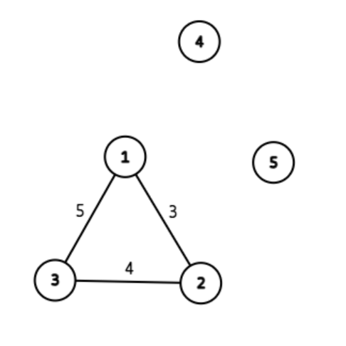

# 闲话

Hack 数据确实比较毒瘤，但是怎么大家都是特判过的啊，那跟没有 Hack 有区别吗（气愤）。

因此本题解代码**没有特判**。

积木鱼是 [Hack 工单](https://www.luogu.com.cn/ticket/QLQX267260)的提出者，自己手搓了两组 Hack，从讨论区和题解的评论区发现了 @[zengziqvan](https://www.luogu.com.cn/user/935908) 和 @[Landscape\_Jing](https://www.luogu.com.cn/user/27721) 的 Hack。同时感谢 @[zhoujunchen](https://www.luogu.com.cn/user/991587) 的帖子让我发了这个工单、@[chen\_zhe](https://www.luogu.com.cn/user/8457) 处理了这个单子。~~然后 cz 处理完工单第二天晚上写完的时候发现题解通道关了，被谷民速度又双叒叕震惊到了。~~

另外本篇是唯一同时写了 Prim 和 Kurskal 两种算法的题解，耗费了~~小 L~~积木鱼 好几个下午（Prim 太难调了 T_T），因此求赞 Qwq，求收藏 OwO。

# 正文

有一个有 $n$ 个点 $m$ 条边的带权无向图，选择一些边使其恰有 $k$ 个连通块，求选择的边的边权和的最小值。

怎么做呢？

我们发现我们选择的边都属于原来的图，因此得到的新图一定是原图的**生成图**，因此不难想到利用**最小生成树**解决。

:::tip[为啥就是最小生成树？]
树的其中一个定义是：无向无环的连通图。

由于是连通块，当然是连通图啦；选择的都是给定的无向边，因此是无向的。

环上的点至少有 $2$ 条路径可以相互到达，我们当然可以破坏掉其中一些边使它们仍然可以通过另一条路径相互到达，即不破坏连通性的情况下无环会比有环更优（题中边权都是非负的）。

综上，无向无环就是连通块内部的最好情况，当然每个连通块因此也就都是树啦。事实上，最小生成树本身就是本题 $k = 1$ 时的特殊情况。
:::

所以怎么求最小生成树呢？

## Krsukal

我们把图清空，也就是只有 $n$ 个点，没有边。

然后利用贪心的想法，优先加边权小的边，因为如果有边权小的边不选而选边权大的边当然是不优的。

但是如果无脑加的话有可能就会出环，为什么呢？

如果这两个节点已经连通了，那么加上这条边还是连通的，这条边除了增加边权以外没有任何用处，反而会新增一条路径，也就是一个环。而我们的生成树也是树，是没有环的。

那我们该如何判连通呢？并查集啊！

然后就做完了，算法只有两步：

1. 把边按边权排序。
2. 遍历每一条边，如果边连接的两点已经连通了就不要；否则就加上来。

时间复杂度分成两部分，排序是 $O(m \log m)$ 的，并查集是 $O(m \alpha(m, n))$ 的，其中 $\alpha$ 为 Ackermann 函数的反函数，非常小，可以认为是常数，故总时间复杂度为 $O(m \log m)$。

需要注意的是，因为需要排序选边，因此不可以直接建图，而是要存下每条边连接的两个点和边权。

## Prim

Prim 和 Kruskal 类似，但是 Prim 是**加点**。也就是每次找和已有的点距离最近的点，然后用连接新的点的边更新其它节点的距离。

哎？这个过程怎么这么像 Dijkstra？Dijkstra 是以起点为中心，不断更新其它点的最短路，而 Prim 是由一个点开始，不断更新其它点的路径……

是的，就是 Dijkstra 改一改，因此也可以用堆优化（事实上，Dijkstra 本人也于 1959 年发现过这个算法）。

但是 Prim ~~个人认为~~相对于 Kruskal 来说并不是很好写，而且常数也略大。

暴力 Prim 是 $O(n ^ 2 +m)$ 的，优先队列优化为 $O((n + m) \log n)$，可以用较为特殊的 Fibonacci 堆优化至 $O(n \log n + m)$。

## 题目

那我们怎么知道 Kruskal 选多少边呢？

按照 Kruskal 的流程，每次连接都是两个之前并没有连通的连通块，连接之后成了一个块，整体上减少了 $1$ 个块，而我们需要 $k$ 个块，只需要 $n - k$ 条有效的边即可。

---

按照 Prim 的 流程也可以做！Prim 不能适可而止，但是我们可以倒回来啊！一棵树上有 $n$ 个点，断掉一条边就增加一个连通块，想要边权和最小我们只需要断掉边权最大的 $k$ 条边即可，时间复杂度 $O(n ^ 2 + m)$（朴素 Prim），对于本题完全可以通过。

这样改造有个要求，我们需要存储方案，放进 `vector` 或者其它数据结构就好了。由于只和边权有关而且要边权最大，这里我用了一个 `priority_queue` 帮我排序最大值（它默认是大根堆）。本题数据量较小，朴素 Prim 即可通过，欢迎大家尝试优化！~~虽然由于复杂度、常数等方面的差异大概率卡不过 Kruskal，何况 Kruskal 已经提前结束了。~~

# 代码

Kruskal 代码：

```cpp
#include <bits/stdc++.h>

using namespace std;

const int N = 3e5 + 10;

int k, m, n, fa[N], cnt, ret;

struct edge {
    int u, v, w;
    bool operator<(const edge& cmp) const { return w < cmp.w; } // 重载小于号，方便排序
} a[N]; // 直接存边

inline int fid(int x) {
    if (fa[x] != x) fa[x] = fid(fa[x]); // 路径压缩
    return fa[x];

}

inline void merge(edge u) {
    int fx = fid(u.u), fy = fid(u.v);
    if (fx != fy) { // 只有不在同一个连通块时才要加边
        fa[fx] = fy;
        ++cnt; // 统计选的边的数量
        ret += u.w; // 统计边权
    }
}

int main() {
    scanf("%d%d%d", &n, &m, &k);
    for (int i = 1; i <= m; ++i) scanf("%d%d%d", &a[i].u, &a[i].v, &a[i].w); // 直接存边
    for (int i = 1; i <= n; ++i) fa[i] = i; // 初始化
    sort(a + 1, a + m + 1); // 排序
    for (int i = 1; i <= m; ++i) {
        if (cnt == n - k) { // 警示后人：一定要先判断，后面讲 Hack 的时候会说为什么要先判断
            printf("%d\n", ret);
            return 0;
        }
        merge(a[i]); // 没到条件就合并
    }
    if (cnt == n - k) {
        printf("%d\n", ret);
        return 0;
    } else printf("No Answer"); // 达不到就是 No Answer
    return 0;
}
```

Prim 代码：

```cpp
#include <bits/stdc++.h>

#define INF 0x3f3f3f3f
#define log printf

using namespace std;

typedef pair<int, int> PII;

const int N = 1010;
int k, m, n, x, y, z, ans, cnt, ret, dis[N];
bitset<N> vis;
vector<PII> g[N];
priority_queue<int> q; // q 用于删边，这里利用了 prioqiry_queue 正好是大根堆的特点

// 并不是很标准的朴素 Prim
void prim() {
    memset(dis, 0x3f, sizeof(dis));
    dis[1] = 0;
    for (int i = 1; i <= n; ++i) { // 注意图不一定连通，因此需要遍历每一个点
        int u = -1;
        for (int j = 1; j <= n; ++j)
            if (!vis[j] && (u == -1 || dis[j] < dis[u])) u = j; // 找到新的点，要求不在树中且边权尽量小
        vis[u] = 1;
        if (i > 1 && dis[u] != INF) q.push(dis[u]), ret += dis[u]; // 加边！加边！加边！同时丢进优先队列里并统计边权
        for (auto v : g[u]) if (v.second < dis[v.first]) dis[v.first] = v.second;
    }
}

int main() {
    scanf("%d%d%d", &n, &m, &k);
    for (int i = 1; i <= m; ++i) {
        scanf("%d%d%d", &x, &y, &z);
        g[x].push_back({y, z}), g[y].push_back({x, z}); // 双向边！
    }
    prim();
    if (q.size() < n - k) log("No Answer"); // 和 Kruskal 一样，压根选不到这么多边就寄了
    else {
        while (!q.empty() && q.size() > n - k) ans += q.top(), q.pop(); // 删边
        printf("%d", ret - ans);
    }
    return 0;
}
```

是不是一个特判都没有呢？

# Hack 数据及原理

与正常题目的 Hack 数据不同，本题的 $4$ 组 Hack 每组 $5$ 分（大部分题目是 $0$ 分，只是会 Unaccepted），原题数据降至每个点 $8$ 分。

## 数据 1

```
2 1 3
1 2 3
```

题目只说了 $N$ 和 $K$ 的值域，又没说大小关系。显然 $2$ 朵云连不成 $3$ 个块，故答案为 `No Answer`。

这组数据 Hack 了原有的 $9$ 篇题解，其中包含一个 $328$ 赞的超高赞题解我谔谔……

## 数据 2、3

```
5 3 2
1 2 3
2 3 4
3 1 5
```

```
7 6 3
1 2 1
1 3 1
1 4 1
2 3 1
2 4 1
3 4 1
```

这两组 Hack 的原理都一样。以上面的一组为例，画出来的图长这样：



不难发现，即使加上了所有的边也只有 $3$ 个连通块，根本不可能有两个块，因此答案是 `No Answer`。本数据 Hack 了原 $5$ 篇题解。

## 数据 4、5

个人认为最毒瘤的一组数据，非常卡边界处理。

```
3 1 3
1 2 3
```

简洁的过分有没有？但是很多题解和代码就是在这里翻车的，错误输出是 `3` 或 `No Answer`。

答案很显然，$3$ 个点构成 $3$ 个块，当然一条边都不用选，答案是 `0`。

究其能 Hack 成功的原因还要看到我们 Kruskal 的部分：

```cpp
for (int i = 1;i <= m;++i) {
    merge(a[i]);
    if (cnt == n - k) {
        printf("%d\n", ret);
        return 0;
    }
}
```

绝大部分代码都是这样子的~~也包括我原来的~~，然后就会挂掉，因为我们是按照顺序执行代码的，因此按照这个逻辑，会先加上那条边，然后才会判断。

可我们一条边都不要啊！因此 `cnt` 变成 $1$ 之后再也不可能变成 $0$ 了，最后 `cnt == n - k` 的判断根本不可能成立，因此会输出 `No Answer` 或此时的 `ret` 值 $3$。

解决方法也很简单，把判断挪到上面去即可。但是注意可能会出现最后一条边才形成答案的情况，因此在循环结束之后仍然需要判断，否则：

```
5 4 1
4 5 1
3 4 2
3 2 3
1 2 4
```

输出是 `10`，不判断就是 `No Answer`（新开题解队列之后有 $1$ 篇题解被这组数据 Hack 掉了）。

---

这组毒瘤的数据干掉了 $7$ 篇题解和原 OI Wiki 上的代码，最终本题原有 $29$ 篇题解一个工单 Hack 掉了 $9 + 5 + 7 = 21$ 篇，创下了一个小小的记录（目前成功添加 Hack 数据并撤下题解中撤解最多的？欢迎大佬超越）。

并且在新增题解后又用最下面的数据 5 Hack 了 $1$ 篇，前前后后单杀了 $22$ 篇题解。

最终可过所有 Hack 数据的 AC 记录放上：

- [Kruskal](https://www.luogu.com.cn/record/233543075)
- [Prim](https://www.luogu.com.cn/record/233962226)

完结撒花！
