【多图警告，体积已尽量优化，如怕耗费流量请在 WiFi 环境下阅读】

Edge 浏览器？这有啥可游的出了多少年了。

其实是 International English Language Testing System--->IELTS--->Internet Explorer Long Time Support--->IE 长期支持版--->Edge 浏览器。~~能从 Language Testing System 扯到 Long Time Support 绝对是 Linux 玩多了。~~

页面链接是 *Journey to the ~~West~~* （《西游记》的英文名）IELTS。

貌似是最后一波纸笔了（今年第四季度及以后就没了），借机缅怀一下。

# 闲话——搞这玩意儿干啥？

TL;DR：~~考着玩儿~~

我们家不是顶级富豪——至少不会请 1v1 家教、人住在郊区、没有房。再加上个人喜好等原因，反正没有也很难有出国留学的想法~~没有房，国内吸引力不足，存在移民倾向，签证都过不了~~（~~虽然但是签证官应该也知道“贫贱不能移”吧~~）。搞升学的话明显科技类优势更大（见本站其它文章），综上用处直接作用没那么大。

但幸运的是爸爸妈妈肯在教育上砸，再加上积木鱼自诩搜索利用资源并自学能力不错，小学阶段成就结算：

二三年级：CEFR A2（IELTS 3 分左右），在二上英语创造了全满分的奇迹（~~虽然小学二年级只要不跟 @[毕导](https://space.bilibili.com/254463269) 做同桌就都很简单就是了~~），但是没去考试，不过足够说服三年级老师让我当英语课代表了（对的，仅仅是为了装说到自己在备考，然后老师：在能力上。。。）。

四年级：CEFR B1（IELTS 4 分左右）。冒着被隔离的风险（~~最后被迫合法逃了两天课~~去了澳门参加 Preliminary English Test(PET，貌似已经改名叫 Preliminary for Schools，但这里仍然使用老办法)，并取得了阅读接近满分的成绩。~~虽然差 1 分上优秀吧，剑桥的平均分技术差评！~~。从此以后养成了吃薯饼的偏好并首次使用了浴缸（~~虽然不是很会~~）（？

五年级：CEFR B2（IELTS $5 \sim 6$ 分。首次去了 CX 考点考试（First for Schools/First Certificate in English，FCE），被口语的 partner 全方位碾压了（但是口语分数仍然是四项最高），写作甚至不及格（停留在 Level B1），不过好歹是及格了并且搞到了不写英语作业的特权（感谢剑桥的平均分技术！~~必须好评！！！~~）。。。养成了去某店吃煎饼果子配豆腐脑的习惯。

> [!CAUTION]
> 这里有必要引入校内公认乐子 Farris，我五年级搞 FCE 它六年级搞，我搞编程它也搞，甚至这几年网名都跟我格式一毛一样就改了个英文名……（好在我改名了），但就是综合竞争力没我强、同学们不喜欢。
> 
> 但是非常奇怪的一点是它英语校内可以经常性比我高。。。不知道是不是我从小搞剑桥系口音偏英式的原因（自认为英音腔比美音好听）。当然我不否认也有我自身的其它原因，但是这确实好气哦 <_>。
>
> Farris 最近转西班牙语去了并且也搞到了 B2，英语貌似暂停了，听他样子是准备转市外国语体系了，Bye Bye!

初一的时候认识了 IELTS 8 分的 Celyne 老师，竟然第一轮考场作文就把我的能力筛出来了，最后以听力第一完形第一阅读第一填空第一匹配第一语法第一作文第一（$14.5/15$）的神仙成绩拿到了单科 & 月考总分的年级第一。

注：这里给一些校内实战数据：一般情况下的英语卷子（不含窄西省特色：~~生活就像海洋，只有意志坚强的人才能到达彼岸~~听说） $10$ 道完形（每题 $1$ 分）+ $3$ 篇阅读理解（$5 \times 3 = 15$ 题，每题 $1.5$ 分）+ $5$ 道短文填空（$6$ 选 $5$） + $5$ 道材料匹配（也是 $6$ 选 $5$，但是每个材料最多 $3$ 句话）+ $10$ 道语法填空 + $1$ 篇作文（满分 $15$），不含作文的话 $20 \min$ 可以做完且全对。目前最快记录是八下期末考，不含作文 $7 \min 31 \text{s}$，属于是批发商了。

初二的时候神仙学校既换同学又换老师了，Celyne 去教了我年级另外两个班，但我们还保持着~~秘密~~联系。

本来想着 FCE 够使了初中不管英语了，但是后来听培优课的时候发现自己的口语能力衰没了（~~你这半衰期也太短了~~），遂主动提出要去提升（埋下伏笔。

笑话一则：其实我学的根本不是英语，而是一个不能念出来但是可以正常输入的积木语。

去小学搞英语的机构继续弄，测了 CEPT（Cambridge English Placement Test，没错又是你剑桥，只测了听力阅读，满分 $50$）成绩记得是听力 $43$ 阅读 $47$），竟然没掉 B2。

鉴于已经这个级别了再去考对标 CEFR C1/IELTS 7.0~8.0 的 Advanced in English（CAE）意义不大，不如直接考 IELTS，认可度要高很多。由于底子不差，所以跳过目标 $5.5$ 的初级班直接进入目标 $6 \sim 6.5$ 的中级班，据说省了大几个 W 学费。

此外上课上到快结束的时候突然说 IELTS 纸笔要没了改成全面机考（相关链接：[官方公告](https://www.chinaielts.org/press-office/IELTS-Chinese-Mainland-Exam-Registration-2026-7-9)）很多人不适应，而纸笔分会高一点（尊嘟假嘟？不是有评分标准吗？（我打字不是挺快的吗（，被逼着报了一场，结果赶上口语换题季有 $1$ 位同学不幸躺枪（好吧他在考前 $1$ 天搞到了回忆版题库

考前上课，上到一半口语单项和总分都是 $8.5$ 的神仙老师离职了（？~~还有隐藏款剧情？~~

抽了 $3$ 个同学，配上四个高级班（目标 $6.5 \sim 7$）老师新建了一个 VIP 班（~~然后这个班中又有 1 个人上了一半儿离开了~~，但是就我一个人是分校的分校，跟总部大佬比起来拉完了（

~~不过我好像成绩也最好哎~~

直接晒**模拟的**成绩单吧嘻嘻（正式考试的成绩在全文最后面；顺便搞到了第二次写作的小分：TA(TR)/CC/LR/GRA 大小作文都是 7/7/6/6；两次都是在 VIP 班测的并且**貌似**是第一）：

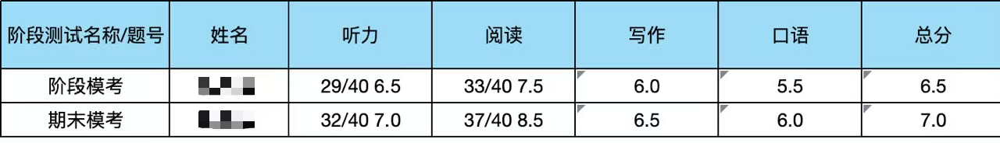

对的阅读冲到了 $8.5$！感觉我总分能上 $7$ 哎。

IELTS 能整到这个程度给任何级别的学校和公司来看都足以说明:

1. 我的英语水平极强，基本干啥都行
2. 我的学习能力也很强，再不济也可以过去教英语

反正学生阶段~~其实干啥都行了，据目前了解通过[同等学力人员申请硕士学位英语水平全国统一考试](https://tdxl.neea.edu.cn/res/Home/2302/5654e9171411e01d1a97d76f5c3ab6cf.pdf?download=同等学力人员申请硕士学位英语水平全国统一考试大纲（第六版）.pdf)申硕都够够的了（好吧憋不出来论文，也没有考试资格~~，没准能试一试入职学校（？。

upd on 2026/08/08：

算了一下：我去教 1v1 的听力和阅读，按照每个小时 ¥200 来算（不贵吧，一堆要价三四百的），每节 $2$ 小时，每天 $6$ 节（我能肝），合计 $200 \times 2 \times 6 \times 365 =876000$，即八十七万六千元每年，即使算上各种神秘因素五六十万还是有的——但是这 TM 是我们家年收入几倍了。

~~那还上个 der 学，打工创业去。~~

---

另外我最近发现我在使用英语的时候已经可以抛下中文的转接层了，并且可以较为流畅的使用英文版的 iPadOS、Windows、VSCodium、微信等产品，属于~~梦到啥说啥~~跟母语一般了，不用再翻译成中文卡 bug 了。

人话：

同学：为啥这么说/选/写？

答：因为我感觉这么说是对的。

因为你不这么整我难受，我别扭。。。

因为不这么搞我弄不出来。。。

因为你不这么选你还能咋选？

~~做题丧失理性，全面拥抱语感想到到哪儿说哪儿~~。

~~于是最近闲着没事儿学点儿法语、世界语之类的东西。~~

Bonjour, Français!

Saluton, Esperanto!

# Day1 考口语

考点是熟悉的 CX，06 月 01 日儿童节（星期一，后来据悉貌似 A 类有星期一到星期三三天随机抽一天，G 类都是星期一）当天 09\:20 的测试，对于住在到哪儿都要一个小时的某郊区还没有车的我们来说简直要命（为啥骑着电动车甚至走路就能到考点的总部大佬是 09\:40 场的 /kk。

听说未成年人会发如图所示的小黄鸭：

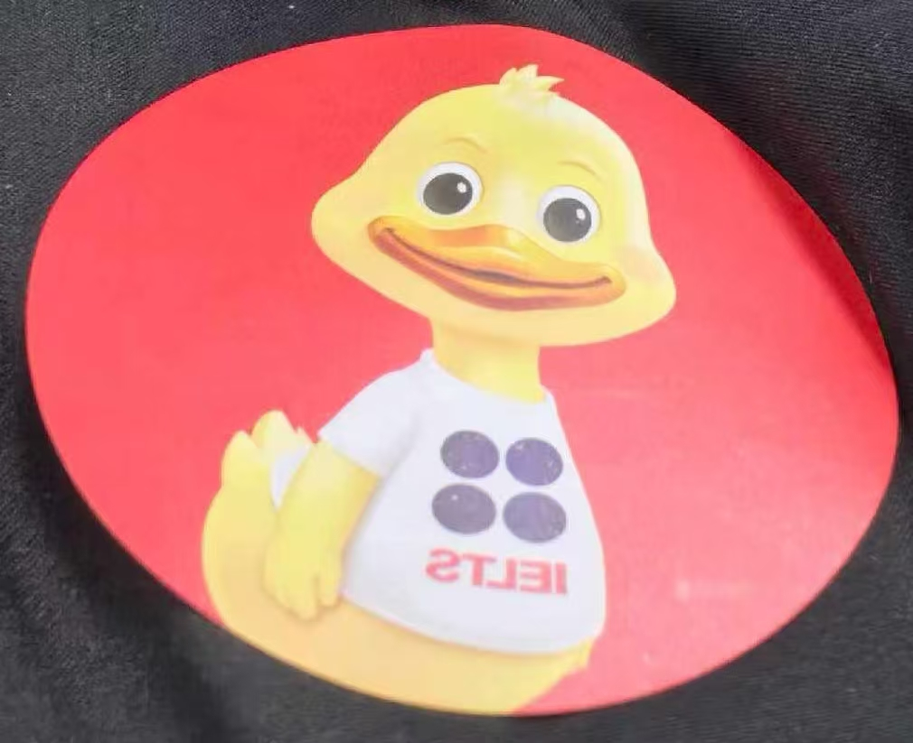

但是为啥 CX 考点没有啊啊啊差评，据说不用（埋下伏笔。虽然说穿着校服（~~被问是高几的了~~）但是老外考官他不！认！识！啊啊啊啊！

人不是很多，但是检录室离厕所太远了差评。负责检录的老师（记为 X，下文会反复提及他）给我身份证上贴了神秘条形码（上面有我的考号，本来想着纪念的但是下一周生地会考实验操作的时候撕了）。剩下就是经典的指纹、拍照、签字等环节。

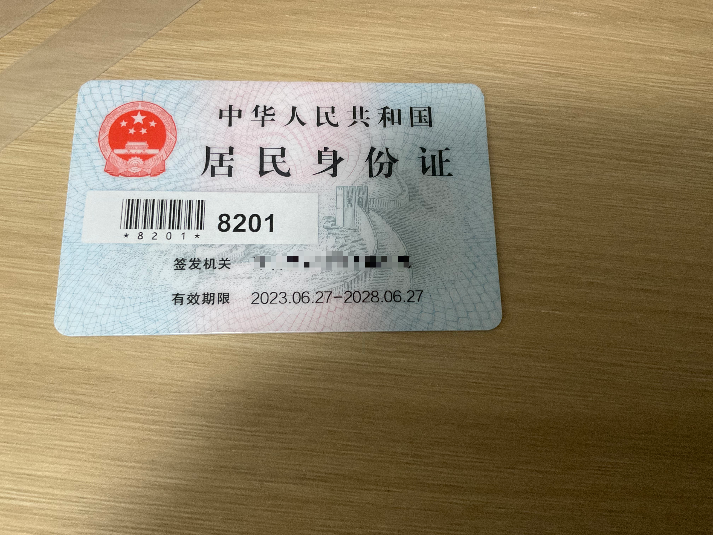

虽然是纸笔考试但是口语已经变成了跟不知道在哪个大洲的考官连线（~~细节用的是 Edge 浏览器~~），匹配了两分钟左右（怪紧张的。。。，跟其他人比起来竟然还算是比较久的了。考场发铅笔和纸用于 Part2，但是不能带出考场（

结论是体验极差，基本不能正常沟通，Part 1 被考官反复强调题目弄得我离题万里一样，最后只能回答 Yes。Part2 撑了不到 $1 \min$ 除了开头基本没有完整的句子（题目：描述一个擅长做计划的人。。。这 TM 是我练过的原题！但是我是 P 人根本没有计划，导致每一次都不知道咋说（。

~~合着 IELTS 卡性格、卡 MBTI~~

Part3 也没好到哪去，摘取两道题：

1. 你觉得做计划对婚礼有啥用？
2. 你觉得做计划对青年在选择职业时的考虑有啥用？

啊我吗，研究婚礼？你看我来这儿考试像是只能去技校/中专考不上高中所以现在就要赶紧做职业规划的样子吗？

~~要不你现场找一个，或者咱俩先领证你先带我走遍婚礼的流程。~~

最后快要超时了被马上叫停了。而且总共考试不到 $20 \min$ 所以赶回学校还在上上午第 $4$ 节课（我校上午 $5$ 节下午 $3$ 节）。没逃过课、没逃过作业，要似了。考前一晚上白瞎刷题库了。

但是和之前 OI 界的一位好友沟通（能力如下，之前的小黄鸭图片就是他拍摄的；目前他人在 BJ，但是有 HK 的户籍而且要转过去了，之后联系会方便很多，祝好）：

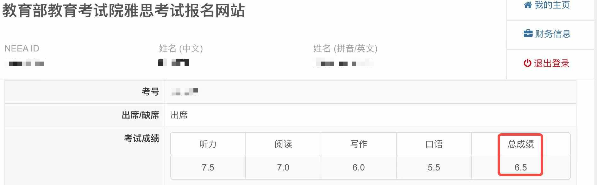

图中某积木鱼听力虚报差评 ~~（光速逃~~。

# Day1.99 笔试前一天

？为啥准考证上没写时间啊？

upd on 2026/06/21：其实是写了的。

What the f**k？07\:30 到？劳资就近入学也就 07\:30 到教室啊？但是这个自行车车程只有 $10 \min$ 你 SEG 要开汽车/坐地铁将近 $1$ 个小时啊？

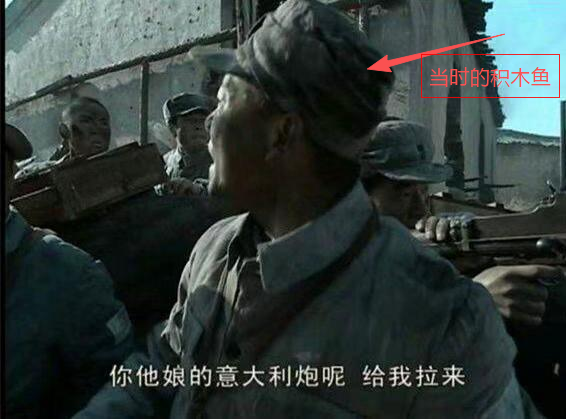

~~都怪洋人发明了 IELTS 害我 07\:30 就要到考场。我要洋人死！！！嘣嘣嘣嘣蹦蹦，嘣嘣嘣嘣蹦蹦，在光绪二十六年，神助拳义和团，扶清灭洋，55 天在。。。~~

要带什么东西也没说？不带文具的吗？索性 2B、HB、中性笔全带上。这波差评（

注：后续回旋镖了（逃

幸亏是考试前一天 ~~zuo 死不写周末作业~~看的。

# Day2 考笔试

## Day 2.0 路上

Day2 是 202**6** 年 **6** 月 **6** 日星期 **6**，据称是几百上千年一遇的传奇（~~巧了我生日也是这样的传奇日期：大家猜一下？~~）。

~~今天是个好日子，心想的事儿都能成，今天是个好日子，打开了家门咱迎春风~~。

最后跟正常点差不多起床，但是 07\:30 才收拾好准备出门，反正 08\:30 才停止检录 ~~去那么早也是堵着。~~ 路上听着 B 站大佬翻的歌（~~由于歌品几乎没有~~就不放清单了。该说不说 Bilibili is undoubtedly the best website(app) for music.

然后听一半~~突然想起来~~自己是去考英语的了，遂请求听一个听力的题目磨耳朵。但是谁家好人一个听力音频的压缩包 470M 啊啊啊。最后压根儿就没传完，也就没听上，真就摆烂了呗。

## Day2.1 入场

把手机还给妈妈了（伏笔），正常进场。但是文具都不让带，白准备那么多了（

一共 $21$ 间考场给我排到了 $\text{Room 19}$，发了一套牌子用于标记寄存的个人物品，一个绑在上面一个自己拿着。

去检录，还是 X，不用做生物信息录入了（好像也有一间另外的屋子做，但是去的人不多我也就没管）。这次发了一个紫色的手环，以及，最重要的，小！黄！鸭！~~我才不会告诉你我差点把自己的行李牌落在那儿了。~~

~~好吧我是蓝色的。~~ But blue is my favourite colour without doubt!How lucky I was!

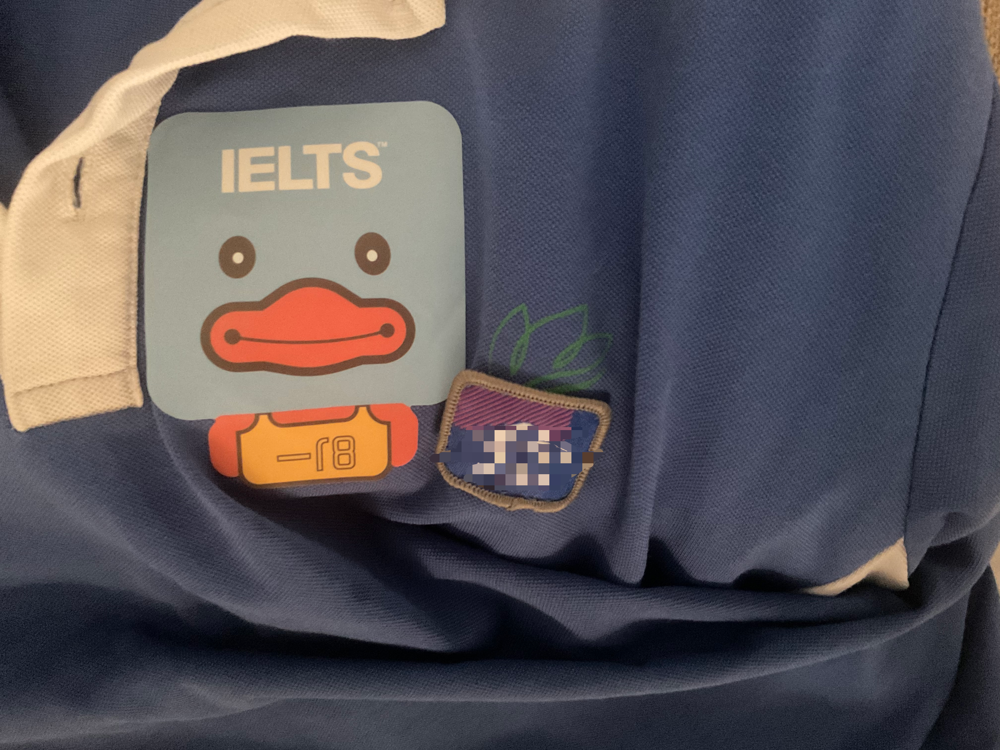

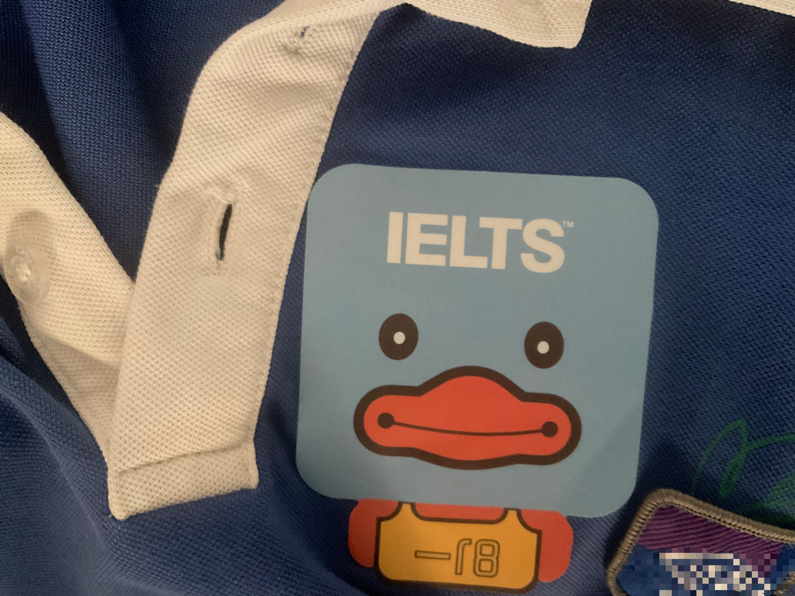

话说鸭子下面的字感觉有点神秘似懂非懂的样子。

~~虽然但是笔试你发小黄鸭管个鸡毛用啊，难不成给我换一套简单的题吗？~~（其实是有用的，后面会讲到，虽然用处奇特

找到 Room 后二次安检（明明进场时做过一次了），但是考官全英操作（事实上她们一直在说英文，但是考生说中文提问她们也能给出中文回应）差点给我问懵了。不过比脸都干净的兜安全过关。前后两个人缺考，左边桌子是用来隔开人的空桌右边是过道，这下被四面夹击了（

原来文具（其实只有铅笔橡皮，但是有 IELTS 的 logo 并且是中国特供版（注意到图中的笔的网站域名里面有 china 字样，但是 .org 域名国内又不能备案注册它干啥？更合理的应该是 [ielts.org.cn](https://ielts.org.cn)。）都给我准备好了啊，怪不得不让带。

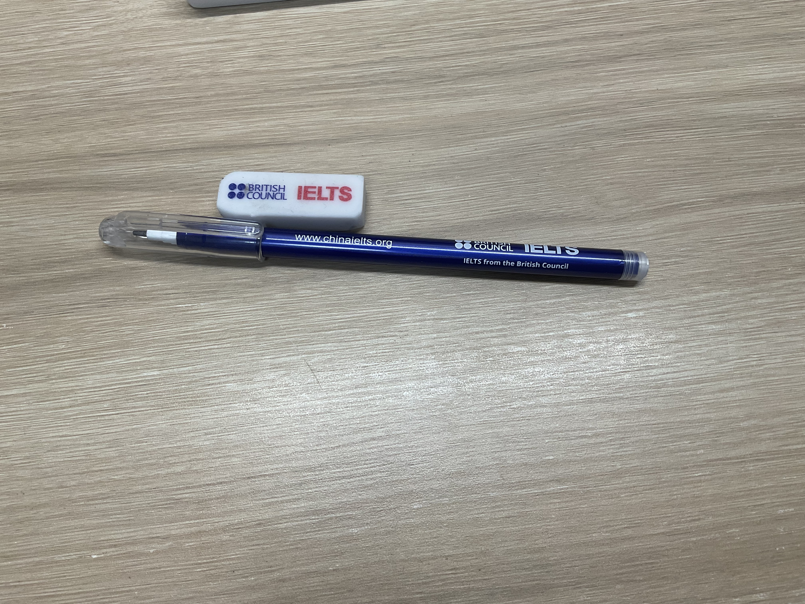

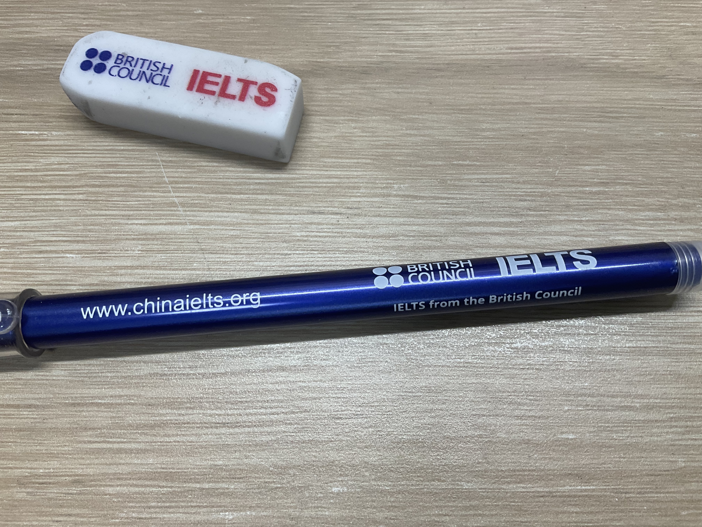

但是此处援引退场后我听的某考生的发言：

> 我才知道原来雅思考试用的是铅笔。

Bon 不 jour 了（~~怎么还有法语~~）。

## Day2.2 听力

填个人信息的时候差点超格了，开局直接使用一次橡皮。与前面的考试不同，IELTS 要求是同身份证一样的名字因此按照中国人的习惯姓在前。

同 PET 一样发放耳机利用电台之类的~~高精尖~~技术放听力。试了两遍音，音量可以自己调节好评。~~上次来 CX 考试直接用电脑外放，但是据说之前施工导致有 1mol 人没听清没过。~~

貌似 A 类 G 类同一套题所以比较简单，基本上每个题目都听出来了。

汇总一下：

Part 1：标准的 $100 \%$ 填空题，是一个女生商量健身的事儿。

Part 2：某区文化/博物馆（记得是个 gallery）建设，一道地图（两层 $7$ 题）+ $3$ 道单选。

Part 3：学生研究的神秘课题：宇航服（刚好学校在学 Space 相关，埋下伏笔）与其特点匹配 + $2$ 道双选。

Part 4：某位意大利（好像是）音乐家的事（莫名记得的背景信息：要办一场这个音乐家的歌曲的音乐会了，所以老师给大家普及一下这位爱用小众高难度乐器使用技巧的 dalao 知识），依旧标准的 $100 \%$ 填空题。

Part 切换之间还给了检查时间，因此读题时间还算充裕。

最后 $10 \min$ 填答题卡的时候空余时间略微难熬。此处强烈谴责耳机大小，考完听力要摘下来收回去（明明考 PET 甚至允许你带回大陆的），耳机太小了耳朵疼。。。不过阅读了几分钟就好了。

## Day2.3 阅读

阅读和听力用的是同一张答题卡（但是貌似不允许你往回翻，跟不允许提前阅读题目/文章是类似的，需要重新填写信息），但是分正反面。记得是听力蓝色、阅读绿色（~~也可能是反过来~~）。用 PDF 展示带考点编号（CN 的 2 号！澳门的 PET 是 MO 的 3 号！）之类的答题卡填涂模板中评（？。另外 PDF 上的信息貌似不是固定的，例如写作为什么是 11:01 开始。。。

这会 A 类一套卷子 G 类另外一套了，所以要填涂自己是 A/G 类。直接把那个方框全给劳资涂黑即可，不要打勾啥的。似乎大部分人都是 A 类（虽然纸笔当中这一场是第二季度最后一场 G 类了，月底还有一场但是只有 A 类）。

同样贴一下题目信息：

Passage 1：记录文，讲述的是两位澳大利亚大佬带着两个美国助手在一位加利福尼亚人的赞助下（没错第一题是判断题：给他们买飞机的人是个美国人）历经风浪完成了人类历史上首次由美国成功飞到澳大利亚，然后被赞助人送了飞机、美国总统发了贺电的事（最终两个美国人回国了，这两个澳大利亚人分别在尝试突破某飞行记录和尝试复刻这次旅程的过程中牺牲）。前面是判断，后面忘了，似乎是单选。

Passage 2：说明文，简介了某种日本陶瓷（是瓷器还是陶器忘了）的一些知识（温度、设备、历史、起源地、地位、传承人和他的故事。。。全部融于一文！）。考了最不擅长、最懵 13 的标题匹配，剩下的考了判断还是个啥东西。

Passage 3：讲对集体是否能提高工作效率的研究，并介绍了两个实验：一个是观察测量发现似乎纤夫一起拉东西的时候出的力比自己一个人的时候出力更少；另一个是把一堆受试者对照实验，让他们完成一项电脑任务，但是第一组啥也不说第二组说要和组内平均分比较，结果发现第二组成绩显著优于前者。第一部分的题目是带有 NB 的 $5$ 个专家和观点匹配，后面出了填空，似乎还有单独的一道单选。

阅读跟听力一样，感觉能上 $9$ 分。基本都会，水爆了。

Passage 3 有一道填空题把 `separate` 填成了 `seperate` 但是被发现了，对照原文后决定改过来。本来以为是英美式，事后查询发现 `seperate` 是我记错了很长时间的经典错误拼法。

另有一道题发现根本没有答案了，最后在可能的答案区间反复寻找了唯一合适的形容词（词性也要合适鸭）塞了进去。

最后强烈谴责两个成年人为什么开始收卷了还在写，最后她们俩拿身份证去登记了并收获一次 Warning。有点同情，但是依旧谴责。

同样需要谴责的还有读到一半打雷了（

## Day2.4 写作

大小作文两张答题卡，小作文是红色的大作文黑的。同样要涂黑自己是 A 类，都要填涂个人信息，两张正反面都要填涂考号。

打开题目 Part 1，迎面一道地图题，方向指针指向北（此处强烈谴责不讲天理的地理考试中方向随机乱指就是不竖直的逆天方向标）。

但是该大学总务处貌似~~贪污~~（~~cos 和珅~~）摸鱼去了，$10$ 年内除了砍了点树、建了一个机房、扩大了一下音乐还是哪个学院的教学楼之外啥也没干。不过最后利用空行式分段 + 纸笔考试不显示词数蒙混过关（虽然我不觉得我已经颓到 $150$ 词都扯不到了）。不过差点整段写错，幸亏是铅笔擦了还能补上（不过如果是机考更改要方便很多）。

笑点解析：有一条小路直通火车站（$\text{train station}$），但是因为在学天文相关的东西所以差点写成了 $\text{space staion}$ 空间站。~~太空电梯，冲出地球，走向宇宙。~~

Part 2 怪有意思的一道题：很多国家已经颁布法律禁止开车时使用手机，但仍有不少司机明知故犯。请问原因是什么？**最好的**解决方案（应该只能要 $1$ 种）是什么？

为了达到字数 + 自己本来习惯性的头脑风暴扯到了 $3$ 种方案，好在最后圆回来了——形式多样，本质如一，思想相同。。。

**求求了多给点分吧。。。**

Part 2 最后答题卡快写满了。这种需要大段修改的情况其实机考要方便很多而且还不用担心我逆天的书写。

其实 Part 1 略微超过了 $20 \min$ 的警戒线，当时看到有人 Part 2 都快写了一面了给我人干懵了。。。结果这哥们儿先写的 Part 2，考试结束了也没写完 Part 1。合着整了半天诈我来了。。。

## Day2.5 出场

收完卷子和答题卡就算笔试考完了，没有人获得 Second Warning。老师巡查全场（我们考场两个监考一人一半，我正好分配到了安检我的那位），撕掉右（左）上角的考生信息卡（注意自己考试过程中撕会被 Score Cancelled/Disqualified，如果缺考的话老师也会帮你撕）、剪掉紫色手环。笔和橡皮竟然可以顺走，但是耳机和试卷当然不行。

拿到行李后要把行李牌重新扣成一对，但是积木鱼手笨不知道该咋扣，遂请求工作人员，然后靠着小蓝鸭免去了嘲讽:)

据称是最后一场纸笔了（其实并不是，暑假还有机会）所以人特别多，怪挤的。

走到上次口语出去的电梯那儿，但是被 X 拍了一下肩膀然后把我赶走了，差！大！评！

挤了半天电梯出去后发现找不到浮木了，跑到旁边店铺申请借手机打电话但是被一口神秘方言拒了（？差评。

绕了一圈跑到另外一家成功获得了联系，然后冒雨跑过去吃煎饼果子配豆腐脑。街上怪冷清的，除了煎饼果子和一家糖水之外基本都倒闭了……

## Day2.6 回家

去立体停车场取车，但是神秘帕拉梅拉车主卡住了把停车场设备干废了:)

补作业去喽（大悲 T_T

# Day3 等待出分

正常上学、偶尔写写这篇游记。考了生地会考的实验操作和体育与健康通识，$5$ 分的会考分和 $2$ 分的中考分就这样轻松到手了。

感受？最开始还想着每天去打卡查一查没准~~跟 CCF 一样~~突然就给我闪击出分了呢？

后来也就这样了，日子该咋过咋过，反正考成几分儿不重要。

好吧其实过了一周到了查分的那一周还是挺紧张的，又几乎每天打卡登录 $114514$ 次（NEEA 网站时间登录存续时间太短了）。。。

出分前一天做了个噩梦：梦到查分结果了，结果一个还不错（记得是 $9.0$？），剩下的一个 $6.0$ 两个 $3.0$（？只有 $3.0$ 会去考雅思？），合计总分是 $5.5$（有意思的是尽管在睡梦中积木鱼的计算结果也是正确的——没错梦里梦到的总分正好是 $5.5$）。

# Day4 出分

出分当天正好是 618 哎！

BC 你是会选日子的，一个个的都给我出这个（而且第二天还是周五又赶上端午假~）。

我校这一周 12\:05 放学，虽然暴雨橙色预警了但是仍然紧张的飞奔回家。

然后发现跟之前一样，网站没有半点儿反应。

气炸了，被诈骗了。难道真到要 $10$ 个还 TMD 是**工作日**吗（心累，毕竟后面可都是假期啊……？

不过所在市其他地方发布暴雨红色预警了可以停课了，中午回家同学这波得了 MVP 两次（嗯没错周二也停了一下午）。

然后下午边摸鱼边写不完整但依旧体量庞大的端午作业，14\:40 不到跑回去看了一下：

听力 $8.0$（破纪录了！），阅读 $8.5$（与个人纪录持平），写作 $7.0$（破纪录了！我那个大作文能给我上 $7$？）、口语 $5.5$（……emm 竟然还有 B2 等级其实我也挺 NB 的了），总分 $7.5$（也破纪录了！！！）CEFR Level C1！

初中段首考出分 $7.5$ 我 TMD 是神仙！！！woc 我 NB ！全体起立！

这个心情，真的，我用母语中文都 TM 词穷了，无法形容。

真的，疯了一下午。

虽然是弱 $7.5$ 但也很知足了（突然发现没有四个 $7$ 好使甚至 4 个 $6$ 都不如，悲）

笑点解析：

1. 本来妈妈想着初中阶段冲到 $6.5$--->模考几次后决定这一次保 $6.5$ 冲 $7$，高一冲 $7.5$，大学再去弄 $8$--->初二一遍 $7.5$ 完事儿了
2. 积木鱼用中级班的课程考出了高级班的成绩，哎，又省到了。~~积木语特色：鼓足干劲，力争上游，多快好省。~~
3. 其实我自认为再考一次大概率每一项（~~口语除外~~但也很难保证超过去）都达不到这个成绩。
4. 据称我们班的那个老师 IELTS 也是 $7.5$。$7.5$ 的成绩理论上可以回到教我的机构机构教课恰钱了。~~老师，我毕业后可以留校吗~~

【前方多图预警，由于截图时间原因深浅色都有，望谅解】

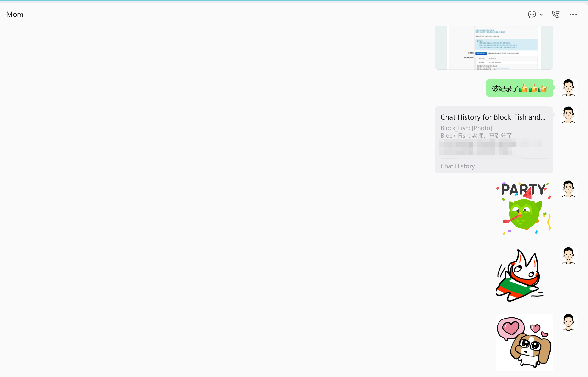

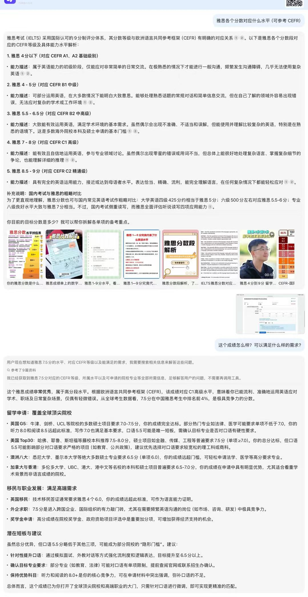

AI 广告差评，但是积木鱼全国前 $4 \%$ NB。~~给 DS 分析然后被建议申请 ￥1400 的复议了。积木鱼：你不知道我口语考场说说的啥吗？这么明显的差距 BC 那边已经复核过了吧。~~

在网上到处寻找，$6 \sim 6.5$ 就算“上岸”了，$7.0$ 就是可以分享经验的高分了，而且除了 $8.5$ 以上的大手子之外所有人至少有一个单项比我的该单项要低。

例如说梦中情校 MIT 的 CS 博士项目**语言**上只要总分到 7 即可~~大家觉得我能进去吗~~，剑桥本身的要求也就是 4 个 $7.0$ 总分 $7.5$。事实上这个分数只要不卡单项分（或者单项分要求在 $5.5$，~~更低的没见过了~~）都是随便进。~~考了这么多剑桥考试了申个剑桥玩儿玩儿。~~

不过神奇的大雨导致航班延误了，官方成绩单第二天才送达。

第二天收到了正式的 Test Report Form，成绩与此一致，CEFR Level C1，安全下车。正面写着信息，背面是对不同等级的描述。

~~但是为什么感觉拍照片的时候我的表情跟那什么 Donald.J.Trump. 有点像。~~

IELTS 的事情也就告一段落了，虽然口语依旧是短板，不过确实是有一点儿提升了，其它的模块直接出去库库乱杀即可。

不过貌似过了一段时间来看，貌似心里怪平静的没啥感觉了？反正一时半会儿没啥大用，就这样吧。

# Day 5 后续

以下均编写于 2026/10/11。

如果我出分 6 分或以下，我会复议/重考。

如果我出分 6.5，那我估计就算了，勉强接受。反正隔壁跟我一块学的本部和市中学大佬也都 6.5。俺们郊区野路子能平起平坐也不错了。

如果我出分 7，那我要好好庆祝一下，这次发挥非常好。

但既然是 7.5，那这事儿它性质就变了。原来没有留学的计划，但现在发现把语言解决后路走的宽多了，且学校也与 HKU 等港校关系不错，每年单 HKU 就稳定送个十几人（要知道对于我们只有 $510$ 人每届的高中部来说这已经是差不多 $2\%$ 了，对于单单一所大学来讲算是超大比例了，除了地理原因的中大华工很少有这么抢手的）。

在解决完语言屏障后，叠加竞赛的优势，个人认为上个港三新二去跟清北对阵还是很有希望的。考虑到 OI 本身在强基考察中没个 der 用，个人认为这是本科超车的好机会。

无论如何，前方通天大道宽又阔。莫名有种外面从来就没下雨的喜感。

另外雅思成绩单更新了，新增了一个 Ofqual Regulated 标记，我申请了更新，和没有标记的（虽然按照官方说明已经失效相当于是寄了）一块藏着。（u1s1 快递员能在一堆英文中找到我们家地址还是太强力）。就是申请查看小分至今没有结果。

后续也看到诸如作弊、泄题、突然终止考试之类的，不过没波及到积木鱼这场。那就踏实摆烂了，跟我没关系那就于我如浮云。

结束了，我赢了，很彻底。
