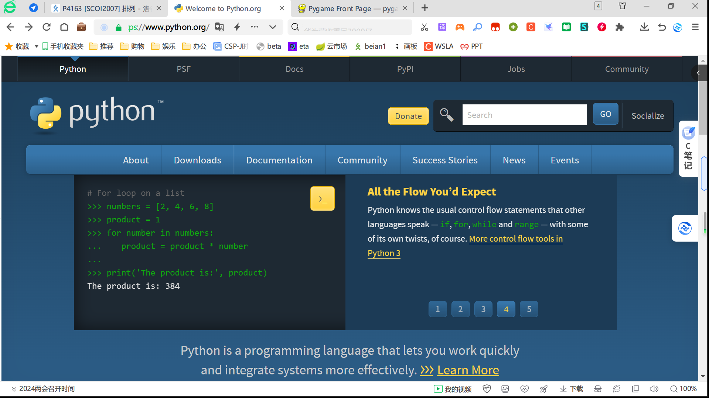
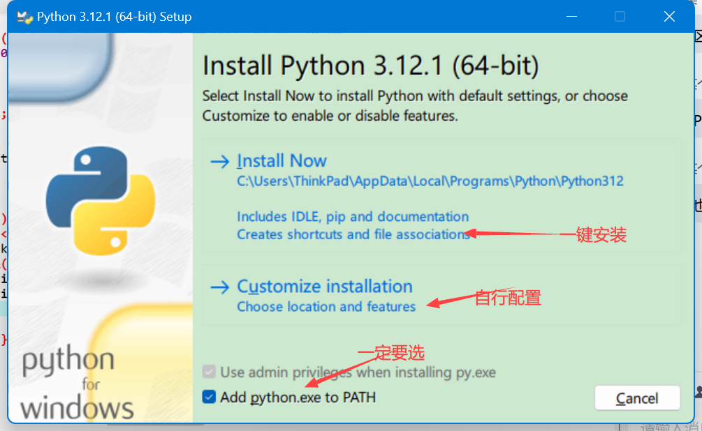
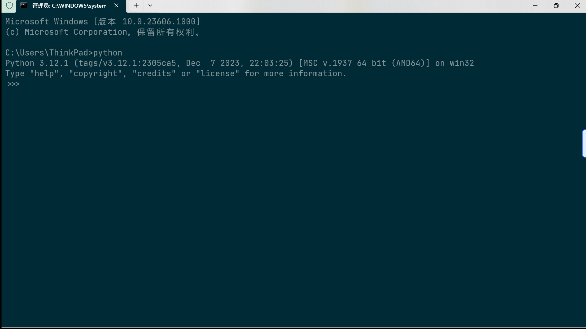
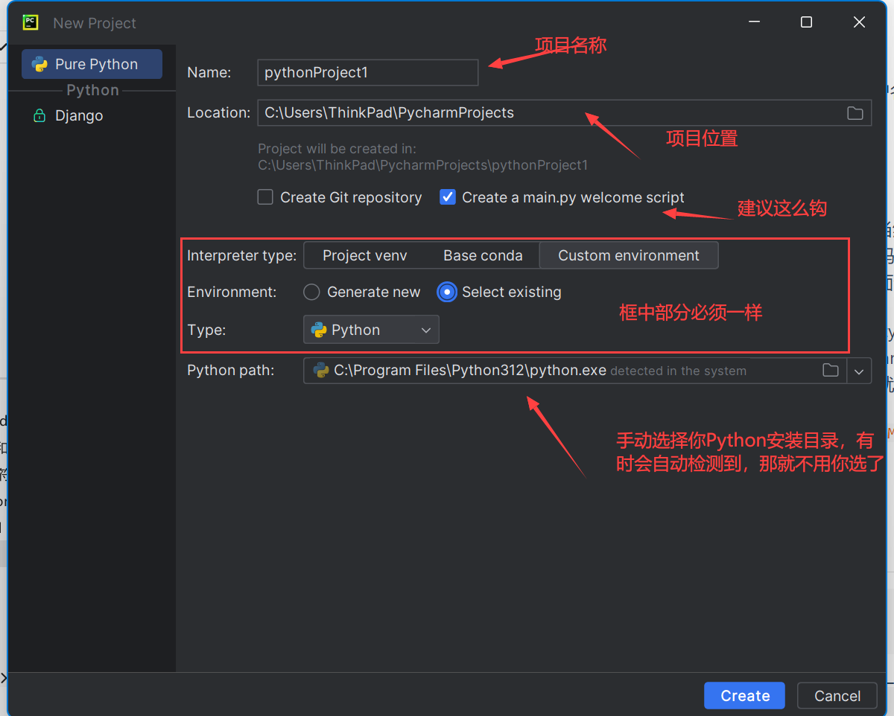

# 安装Python

## 下载安装Python

要用 Python，那肯定得先装个 Python 呐！

<!--more-->

先把 [Python 官网](https://www.python.org/)扒出来。访问速度一般不咋滴，请耐心等待~

如果正常，应该能出来个这个：

~~TMD 我等了半天出来个我不认识的全英版本？~~

~~是的，就是这样的。~~

没事，我帮你翻译。选 Downloads，鼠标在上面停留一会，会出现一个列表。直接选你用的系统（Win 就选 Windows，macOS 就是 macOS，Linux 的……~~自己找教程去吧，官方大概率没有~~ 先去包管理器看看，没有那就可以去 Other Platforms 瞅一瞅，还是没有那 [GitHub 官方仓库](https://github.com/python/cpython) 自行编译或者 BDFS 吧），然后如下操作（macOS 会有一个`universal2 installer`，下载后打开，按指示操作就可以了）。


看图操作就好。下载可能比（fei）较（chang）慢，导入迅雷之类的下载器下载就好。

下载下来当然要打开啦（废话），正常情况下如图：



勾了 `Add python.exe to PATH` 选项后一键安装就可以了。

然后静静地等着它安装。

安装的同时，可以去隔壁 [JetBrains官网](https://www.jetbrains.com.cn)看看，这里有待会要用的IDE——Pycharm。

安装完后，按 Win + R，输入 `cmd`，在弹出的窗口中输入 python（如果是 Linux/macOS，因为这两者系统中似乎内置一个 Python 的 2.x 版本，你需要做的是在终端中输入python3，相应地，后面的pip也要替换成pip3），如果结果如图，那么恭喜你，Python 安装成功（请注意！如果你没勾 `Add python.exe to PATH` 这个选项，那么你电脑是查不到的！这种情况下需要你配置一下环境变量，每个版本的 Win 都不太一样，自己度娘去，实在不行重装吧……）！



## 配置pip

下一步，是配置 pip。pip 是用来管理外部库的，类似应用宝。pip 默认的下载地址在国外，链接可能会 TLE，需要配置一下。

### Linux/macOS用户：

打开配置文件 `~/.pip/pip.conf`（不存在就创建），修改如下：

```ini
[global]
index-url = https://pypi.tuna.tsinghua.edu.cn/simple
[install]
trusted-host = https://pypi.tuna.tsinghua.edu.cn
```

这里，`https://pypi.tuna.tsinghua.edu.cn/simple`是清华的镜像站，除了清华的，常用的还有：

|     名称     |                                               网站                                               |
| :----------: | :----------------------------------------------------------------------------------------------: |
| 南科大镜像源 | [https://mirrors.sustech.edu.cn/pypi/web/simple](https://mirrors.sustech.edu.cn/pypi/web/simple) |
| 阿里云镜像站 |         [http://mirrors.aliyun.com/pypi/simple/](http://mirrors.aliyun.com/pypi/simple/)         |
|  豆瓣镜像站  |                 [http://pypi.douban.com/simple/](http://pypi.douban.com/simple/)                 |
| 中科大镜像站 |       [ https://pypi.mirrors.ustc.edu.cn/simple](https://pypi.mirrors.ustc.edu.cn/simple)        |

### Windows用户

conf 文件在 `C:\Users\xx\pip`（xx是你用户名），其它的照抄Linux/macOS的即可。

## 升级turtle库

这个步骤不是必须的，但很推荐操作。

现在你终端中跑一下这行代码：

```shell
pip install turtle --upgrade turtle
```

肯定会炸。翻到上面以`Using cached xxx (xxkB)`开头的那玩意，中间的部分是一个链接，用浏览器打开，会自动下载下来。 

跑到下载目录，解压压缩包，找到setup.py，用记事本或者其它任何能编辑文本的东西打开（如果你装了下面的PyCharm，也可以用它）。找到第40行，更改成下面的样子：

```python
except (ValueError, ve):
```

保存，在终端中切到这个目录，运行以下代码：

```shell
pip install -e turtle-0.0.2
```

现在应该就成功啦！

# 安装PyCharm

这样 Python 就整完了，安装 PyCharm 去（当然，如果你愿意用 VSCode、Sublime Text 之类的其它工具写代码，我也不拦着你，但切记不要用自带的 IDLE 写，原因嘛[这里](https://leo2011.eu.org/2023/12/29/pythongui-tu-xing-hua-jie-mian-xiang-jie/)有讲）。也就是说，Python 是自带一个编辑器（Intergrated Developing and Learning Environment, IDLE）的，只不过不太好用而且可能出问题就是了。

[到这里](https://www.jetbrains.com.cn/pycharm/download/?section=windows)，把页面拉到底部，下载 Community Edition 就可以了（Professional Edition 是付费的，而 Community 是免费的）。这次安装包是中文的，按指示操作就好。

打开 PyCharm，会出来一个 `JETBRAINS COMMUNITY EDITION TERMS`，直接点下面的勾后 `continue` 就好。

然后的界面中，点击 `New Project`（新建一个项目，不建就没法使 PyCharm），在新的窗口中如图配置，配置好后点 `Create` 就好了。


配置好后，就可以愉快的享受被誉为“宇宙最强 Python IDE”的 PyCharm 了！
